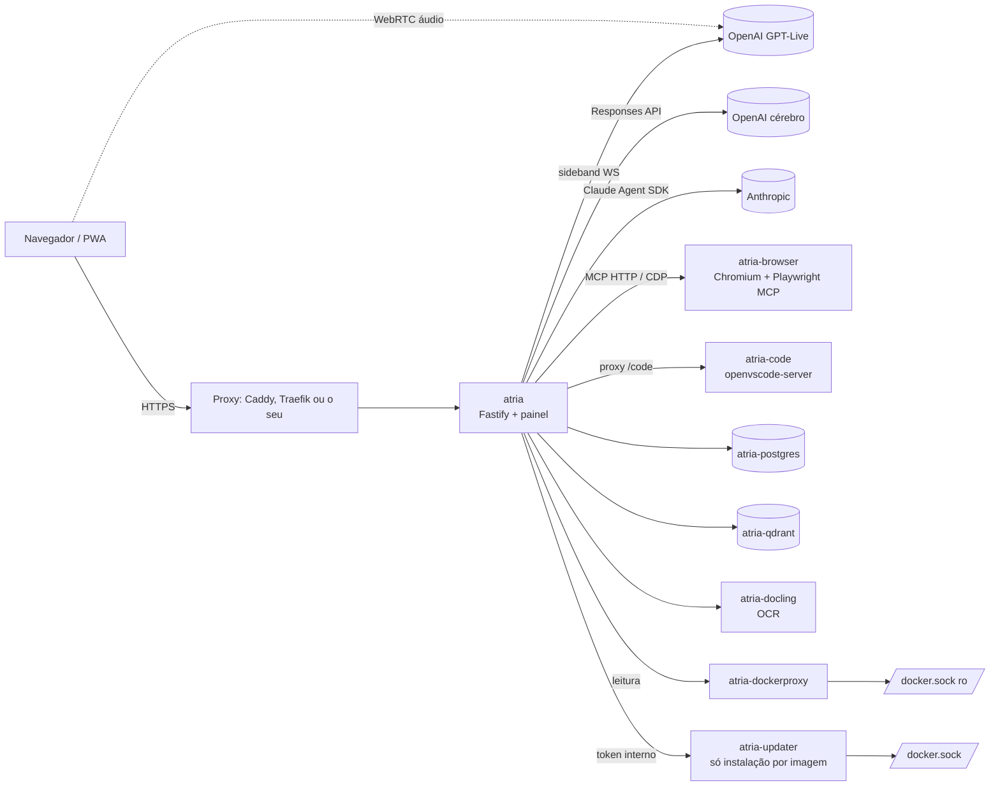

# Arquitetura

Visão interna do Atria OS: como os serviços conversam, onde mora cada responsabilidade no código e onde
ficam os dados. Para instalar, veja o [README](../README.md) e a [referência de instalação](instalacao.md).

## Ideia central

A **Yui** é a interface (voz e texto); o **Claude Code** é a força de trabalho. A Yui entende o pedido, mexe
na tela e, quando há trabalho de verdade, delega para um agente Claude Code que roda dentro do próprio
container, com a conta Claude do dono.

Só o serviço `atria` recebe tráfego de fora. Os demais serviços ficam na rede interna do compose; o VS Code e a
transmissão do navegador passam pelo Atria OS, atrás do mesmo login.

## Fluxo de um pedido

1. **Voz** — o navegador abre WebRTC direto com o GPT-Live (`POST /api/live/session` devolve a credencial).
   O servidor acompanha a mesma sessão por um *sideband* WebSocket em modo `delegation: client`
   (`server/src/live.ts`). Quando o modelo de voz delega, o pedido vai para o cérebro e a resposta volta
   como comentário narrado.
2. **Texto** — `POST /api/chat` vai direto ao cérebro (`server/src/brain.ts`, OpenAI Responses API com tools).
3. **Cérebro** — escolhe tools de tela (`open_*`), de memória (`vault_*`, `empresa_consultar`, `ajuda_consultar`),
   de tempo (`ambiente_*`, lembretes) ou de trabalho (`delegate_task`, workflows, missões).
4. **Agentes** — `delegate_task` cria uma execução em `server/src/runs.ts`, que roda o Claude Agent SDK no
   projeto (`/workspace/<slug>`), com o prompt do agente (`/workspace/.claude/agents/*.md`) e os servidores MCP
   (navegador, Empresa, conectores da conta Claude). `canUseTool` passa por `safety.ts` (bloqueia só o
   catastrófico) e pelos `approvalPatterns` do `atria.json` do projeto, que viram aprovação no painel/push.
5. **Resultado** — eventos de execução saem pelo barramento SSE (`bus.ts`, `GET /api/events`) para todas as
   abas abertas; `vaultAuto.ts` registra relatório ou linha de diário no Vault; a Yui narra o desfecho.

## Servidor (`server/src`)

TypeScript executado direto pelo Node 24 (`node src/index.ts`, sem etapa de build).

| Área | Arquivos | Responsabilidade |
|---|---|---|
| Núcleo | `index.ts`, `config.ts`, `settings.ts`, `db.ts`, `auth.ts`, `onboarding.ts`, `bus.ts` | Fastify, rotas base, configuração (banco > `.env`), SQLite, sessão/senha, primeiro acesso, SSE |
| Yui | `brain.ts`, `live.ts`, `ambiente.ts`, `lembretes.ts`, `push.ts` | cérebro com tools, voz GPT-Live, noção do agora, lembretes/timers, Web Push |
| Execução | `runs.ts`, `agents.ts`, `agentsAdmin.ts`, `safety.ts`, `trust.ts`, `capabilities.ts`, `terminal.ts` | fila de agentes Claude Code, catálogo/edição de agentes, bloqueio catastrófico, terminal (node-pty + tmux) |
| Orquestração | `missions.ts`, `workflows.ts`, `workflowMarkdown.ts`, `routines.ts` | missões, workflows em Markdown + Mermaid, agendamentos |
| Projetos | `projects.ts`, `github.ts`, `sandbox.ts`, `docker.ts` | repositórios GitHub, clones no workspace, preview isolado, leitura de containers |
| Memória | `vault.ts`, `vaultIndex.ts`, `vaultAuto.ts` | Vault Obsidian (API, grafo de links, commits automáticos, relatórios) |
| Empresa | `company/*` | base de conhecimento: upload validado, Docling, extração, embeddings, busca híbrida, espelho no Vault, MCP para agentes |
| Painel | `customViews.ts`, `toolbox.ts`, `browserLive.ts`, `stats.ts`, `metrics.ts`, `help.ts`, `helpDocs.ts` | telas customizadas, ferramentas, navegador ao vivo, números, Ajuda |

**Extensões** (`extensions.ts`): módulos se registram com `registerBrain` (tools e prompt do cérebro),
`registerRunPrompt` (texto extra no prompt dos agentes) e `registerAgentOptions` (MCP e opções do SDK), sem
editar `brain.ts`/`runs.ts`. Um módulo novo segue o mesmo formato: exporta `register(app)` e entra na lista
de `index.ts`.

## Painel (`web/src`)

React + Vite, instalável como PWA.

- `shell/`, `yui/`, `voice/` — modo conversa: orbe da Yui, conversa, voz.
- `app/` — modo dashboard (`/app/*`): `AppShell`, `Sidebar` (desktop), `NavRail` (tablet), `BottomTabs`
  (celular), `MiniOrb`, e `pages/` com uma página por área.
- `views/` — telas compartilhadas pelos dois modos (execuções, workflows, terminal, agentes…).
- `vault/`, `brain/`, `company/`, `workflow/`, `help/` — módulos de cada área.
- `store/` (estado), `api/` (cliente HTTP/SSE), `lib/device.ts` (classe de aparelho), `pwa/` (service worker).

`shared/` guarda o que os dois lados usam: `protocol.ts` (tipos de eventos e API) e `workflowMarkdown.ts`.

## Versões e atualização

Uma tag `vX.Y.Z` publica as imagens no GHCR (`.github/workflows/release.yml`). Na instalação por imagem
(`deploy/install-release.sh`), o `docker-compose.yml` usa `ghcr.io/eliveutonsouza/<imagem>:${ATRIA_TAG}`; a de
código soma o `docker-compose.build.yml` e builda na VPS. O Atria Central manda o comando `update` pelo pulso; o
Atria OS drena as execuções e chama o `atria-updater` (`updater/src`: `updater.ts` faz os passos e o rollback
com um executor de comandos injetável, `server.ts` é a API HTTP, `exec.ts` roda o docker CLI). Depois do
reinício, o Atria OS lê `GET /status`, informa o resultado ao Central e confirma com `POST /ack`.

## Dados

| Onde | O quê |
|---|---|
| volume `data` → `/data` | SQLite (`atria.db`: sessões, execuções, aprovações, kv, lembretes, settings), `HOME` com logins do Claude e do GitHub, arquivos da Empresa |
| volume `workspace` → `/workspace` | projetos clonados, `.claude/agents`, `.atria/` (Vault com git próprio, workflows, toolbox, saídas do navegador) |
| volume `pg` | Postgres da Empresa: documentos, trechos, campos, fila de processamento |
| volume `qdrant` | vetores da Empresa |
| volume `browser-profile` | perfil persistente do Chromium dos agentes |
| `workspace-seed/` (imagem) | Vault, workflows e ferramentas iniciais, copiados uma vez no primeiro boot |

O `atria` roda como `node` (uid 1000); o `atria-browser` roda como root e devolve a posse de
`/workspace/.atria` ao uid 1000 ao subir.

## Segurança

- Um usuário: senha com hash Argon2, cookie de sessão assinado, rate limit no login, Helmet/CSP.
- Docker só por `atria-dockerproxy` (somente leitura); nenhum serviço interno tem porta publicada. A exceção
  com escrita é o `atria-updater` (instalação por imagem): rede interna, token, só aceita tags `vX.Y.Z` e só
  roda `pull`/`up` dos serviços do próprio compose.
- Agentes no automático, com bloqueio de comandos catastróficos (`safety.ts`) e aprovação explícita onde o
  projeto ou o workflow pedir; exclusões pedidas à Yui sempre passam por aprovação.
- Imagens de terceiros fixadas por digest; CI roda gitleaks em todo push.

## Testes

- `server/test/*.test.ts` (`node --test`): Vault, workflows, Ajuda, exclusões, etc.
- `updater/test/*.test.ts` (`node --test`): passos do atualizador, rollback e API, com executor falso.
- `server/scripts/eval-brain.ts`: bateria de pedidos reais contra o cérebro (gasta tokens).
- `e2e/run.mjs` e `e2e/mobile.mjs`: Playwright contra uma instância rodando (desktop e 6 aparelhos).
- CI (`.github/workflows/ci.yml`): gitleaks, tipos e testes (servidor e atualizador), lint e build do painel,
  `docker compose config` nos três modos de proxy (por imagem e a partir do código) e build das três imagens.
