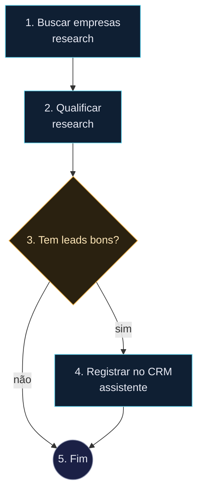

# Leads diários

## 1. Buscar empresas
- tipo: tarefa
- agente: research
- instrução: Use o Apify (Google Maps) para encontrar até 30 empresas locais em São Paulo de nichos de serviço (clínicas, escritórios, academias). Para cada uma colete nome, site, telefone, Instagram e nota no Google.
- mcp: [Apify, Firecrawl]
- saída: empresas

## 2. Qualificar
- tipo: tarefa
- agente: research
- instrução: Dê score 0–100 de oportunidade (sem site, site fraco, sem conversão, presença ativa) e escolha as 10 melhores com o motivo e a oferta recomendada (site, CRM, automação).
- saída: qualificados

## 3. Tem leads bons?
- tipo: decisão
- condição: Existe pelo menos 1 empresa com score acima de 70?

## 4. Registrar no CRM
- tipo: tarefa
- agente: assistente
- instrução: Cadastre as empresas qualificadas (score > 70) no Twenty esm-softwares como companies com nota contendo score, motivo e oferta. Não envie mensagens a ninguém.
- mcp: [Twenty esm-softwares]

## 5. Fim
- tipo: fim
