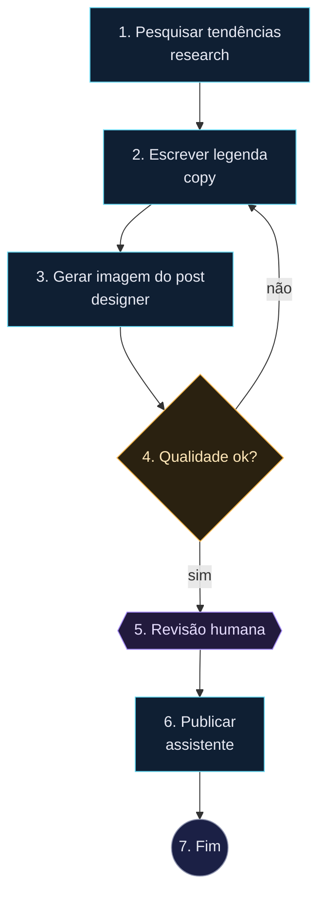

# Post Instagram

## 1. Pesquisar tendências
- tipo: tarefa
- agente: research
- instrução: Pesquise 3 temas em alta para o público do perfil (desenvolvimento, IA aplicada a negócios, produtividade). Para cada tema traga gancho, ângulo e por que deve engajar. Use busca na web e Firecrawl quando útil.
- mcp: [Firecrawl, Apify]
- saída: temas

## 2. Escrever legenda
- tipo: tarefa
- agente: copy
- instrução: Escolha o tema mais forte entre os pesquisados e escreva legenda para Instagram em português (gancho na 1ª linha, até 150 palavras, CTA e 5–8 hashtags). Sugira também o texto da arte (no máximo 8 palavras).
- saída: legenda

## 3. Gerar imagem do post
- tipo: tarefa
- agente: designer
- instrução: Crie a arte quadrada 1080x1080 para o post usando o texto da arte e a identidade do perfil. Use Higgsfield (generate_image) ou Claude Design. Entregue o link/arquivo da imagem final.
- mcp: [Higgsfield]
- saída: imagem

## 4. Qualidade ok?
- tipo: decisão
- condição: A legenda e a imagem estão prontas para publicar (tema forte, texto sem erros, arte legível e alinhada à legenda)?

## 5. Revisão humana
- tipo: aprovação
- instrução: Revise legenda e imagem antes da publicação.

## 6. Publicar
- tipo: tarefa
- agente: assistente
- instrução: Publique a imagem com a legenda no Instagram via Composio (ou Facebook/Instagram quando autorizado). Se nenhum conector puder publicar, salve legenda e imagem no Google Drive na pasta "Instagram/Pendentes" e avise.
- mcp: [composio, Google Drive]

## 7. Fim
- tipo: fim
