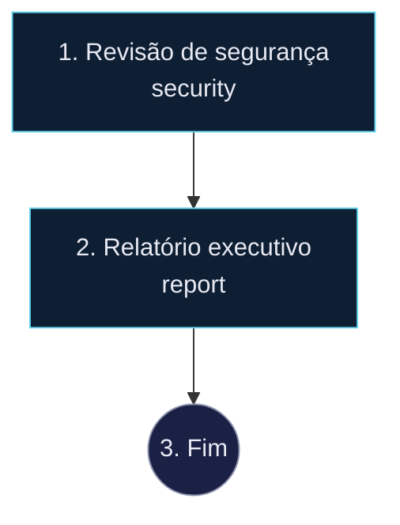

# Revisão semanal dos repositórios

## 1. Revisão de segurança
- tipo: tarefa
- agente: security
- instrução: Nos repositórios clonados em /workspace com commits nos últimos 7 dias, rode auditoria de dependências (npm audit ou equivalente) e procure segredos expostos. Liste achados por severidade com arquivo:linha. Não altere código.
- saída: achados

## 2. Relatório executivo
- tipo: tarefa
- agente: report
- instrução: Gere o relatório semanal (Destaques, Riscos, Próximas ações) a partir dos achados de segurança e do git log da semana dos projetos ativos.

## 3. Fim
- tipo: fim
